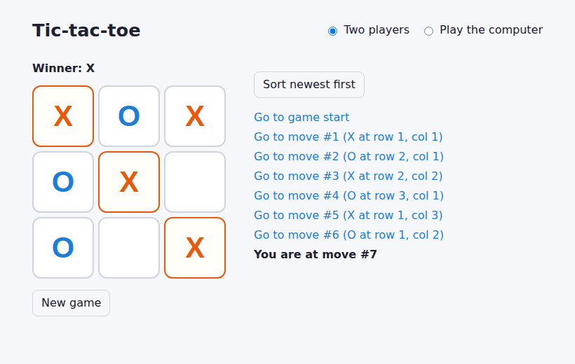

# Tic-tac-toe

[](https://github.com/kartikey13kaushiq/React-js-day1/actions/workflows/ci.yml)
   

The [react.dev tutorial](https://react.dev/learn/tutorial-tic-tac-toe) game, finished and
extended:

- every "extra credit" exercise;
- an unbeatable computer opponent;
- strict TypeScript;
- a test suite that proves the opponent never loses.



## Features

- **Time travel.** Jump to any earlier move. Playing from there starts a new branch, the way
  undo works in an editor. Each history entry shows who moved where ("X at row 2, col 2").
  The history can be sorted newest-first.
- **Tutorial extras.** The board is rendered with loops. The winning line is highlighted, draws
  are announced, and "You are at move #n" replaces the button for the current move.
- **Play the computer.** The opponent uses minimax with memoisation. It prefers faster wins and
  slower losses, and breaks ties by preferring the centre, then corners, then edges. It replies
  after a short pause, including when you travel back to a position where it is to move.
- **Accessible.**
  - Squares are a labelled grid ("Row 1, column 3: X").
  - The game status is a live region, so screen readers announce moves and results.
  - Everything works from the keyboard.
- **Separated concerns.** The rules (`src/game/logic.ts`) and the AI (`src/game/ai.ts`) are
  pure TypeScript with no React in them. The components only render state.

## Run it

```bash
npm install
npm run dev        # http://localhost:5173
npm run build      # static files in dist/ (relative paths, so any sub-path works)
```

Pushes to `main` deploy to GitHub Pages. To enable this, set Settings → Pages → Source to
"GitHub Actions".

## Quality

```bash
npm run check      # ESLint, tsc --noEmit, Vitest with coverage thresholds, production build
```

There are 23 tests, all lines are covered, and CI enforces at least 90% coverage.

- **Rules:** every winning line, draws, turn order, immutability, illegal moves.
- **AI:** takes wins, blocks losses, opens in the centre. Two exhaustive tests play *every
  possible* sequence of opponent moves, with the AI as O and then as X, and assert that it
  never loses.
- **UI (Testing Library):** full games to a win and to a draw; time travel with branching;
  sorting; the computer answering, blocking a threat, and winning with a fork after a weak
  line; resetting.

The project was originally created with Create React App, which is no longer maintained. It
was migrated to Vite, and the 37,000 `node_modules` files that had been committed were
removed from version control.

## License

[MIT](LICENSE)
